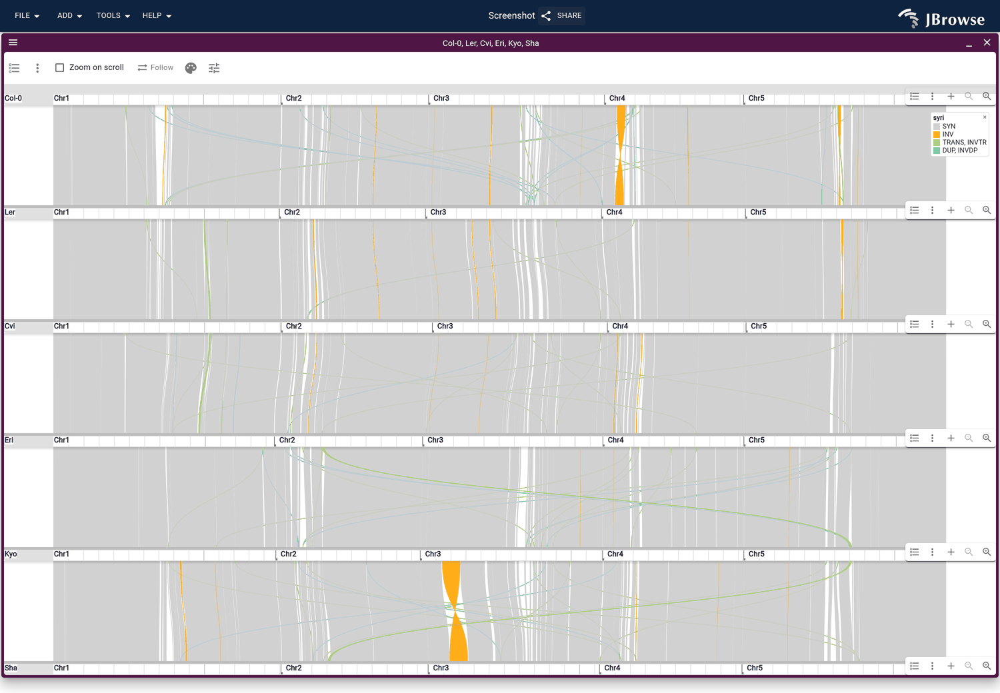

# syri2jbrowse

Turns [SyRI](https://github.com/schneebergerlab/syri) output into a
[JBrowse 2](https://jbrowse.org) config: each syntenic, inverted, translocated
and duplicated region a ribbon colored by its type, the genomes stacked as
[plotsr](https://github.com/schneebergerlab/plotsr) stacks them.



The [SyRI tutorial](https://jbrowse.org/jb2/docs/tutorials/syri_synteny/) walks
through it on six Arabidopsis accessions.

## Install

```bash
pip install git+https://github.com/cmdcolin/syri2jbrowse
```

Python 3.9 or later, no other dependencies.

## Run

It takes plotsr's arguments:

```bash
syri2jbrowse --genomes genomes.txt --sr A_Bsyri.out --sr B_Csyri.out -o out
```

Open `out/config.json` in
[JBrowse Desktop](https://jbrowse.org/jb2/docs/quickstart_desktop/), or serve
`out/` beside [JBrowse Web](https://jbrowse.org/jb2/docs/quickstart_web/) and
open `?config=out/config.json`.

Add a SyRI run of each genome against the first, and the config also draws
every genome as a lane in the first one's coordinates, with a row of its regions
on that genome:

```bash
syri2jbrowse --genomes genomes.txt --sr A_Bsyri.out --sr B_Csyri.out \
  --pair A C A_Csyri.out
```

## Arguments

- `--genomes`: plotsr's genomes file, `<file>\t<name>[\t<tags>]` per genome in
  stack order. A file is a FASTA (read from its `.fai` when present) or, tagged
  `ft:cl`, a chromosome-length table.
- `--sr`: a `syri.out` or plotsr BEDPE per neighbouring pair, genomes 1 and 2
  first.
- `--pair REF QRY FILE`: any other pair.
- `--cfg`: plotsr's config file, for `syncol`, `invcol`, `tracol` and `dupcol`.
- `-s`: the stacked view hides regions shorter than this, 10000 by default, as
  plotsr does.
- `-o`: the output folder, default `syri_jbrowse`.

The folder holds `config.json`, `syri.paf` (every region, its type in the
`syri:Z:` tag), `syri_regions.bed` (the regions against the first genome) and a
`.chrom.sizes` per genome, named relatively so it moves as a whole.
